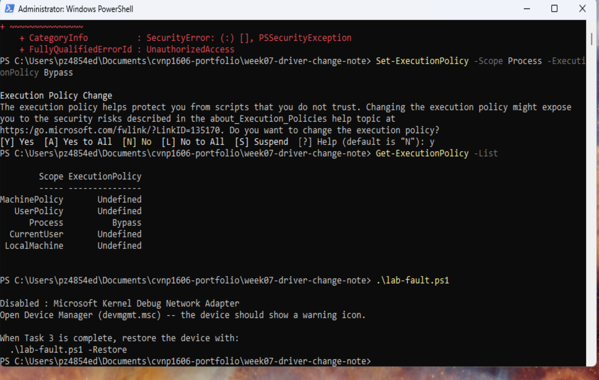
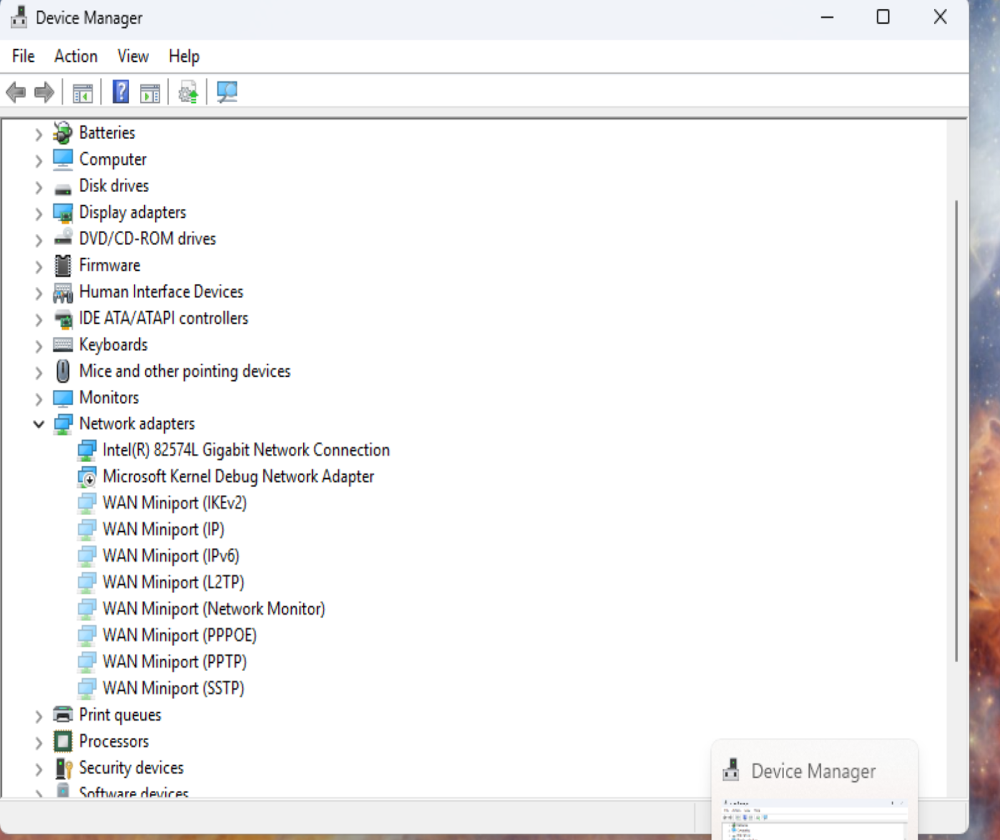
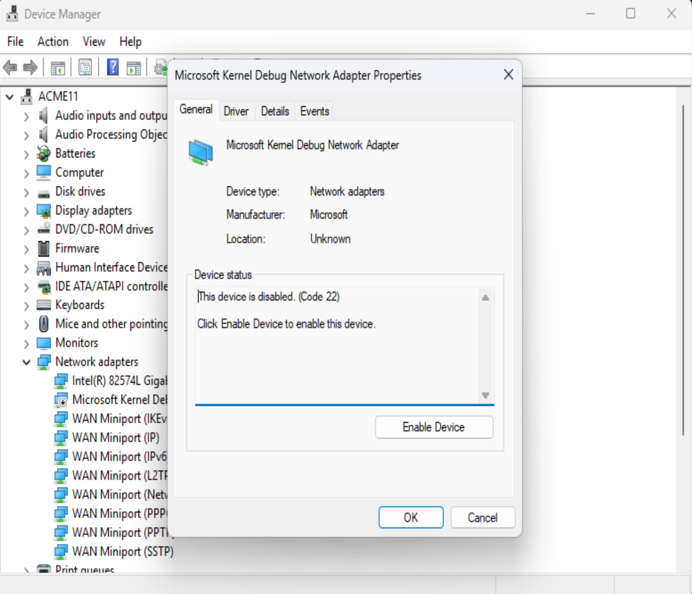
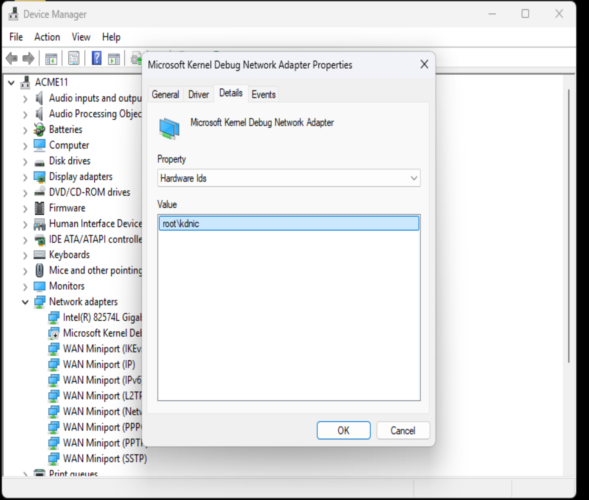
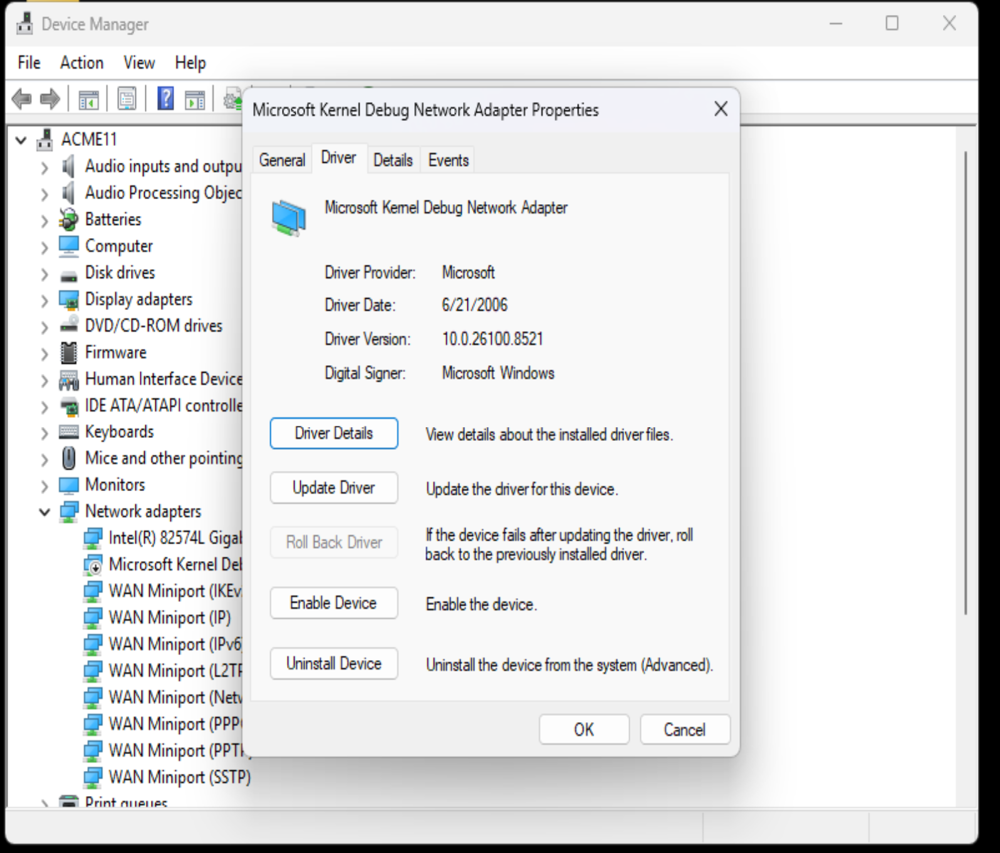
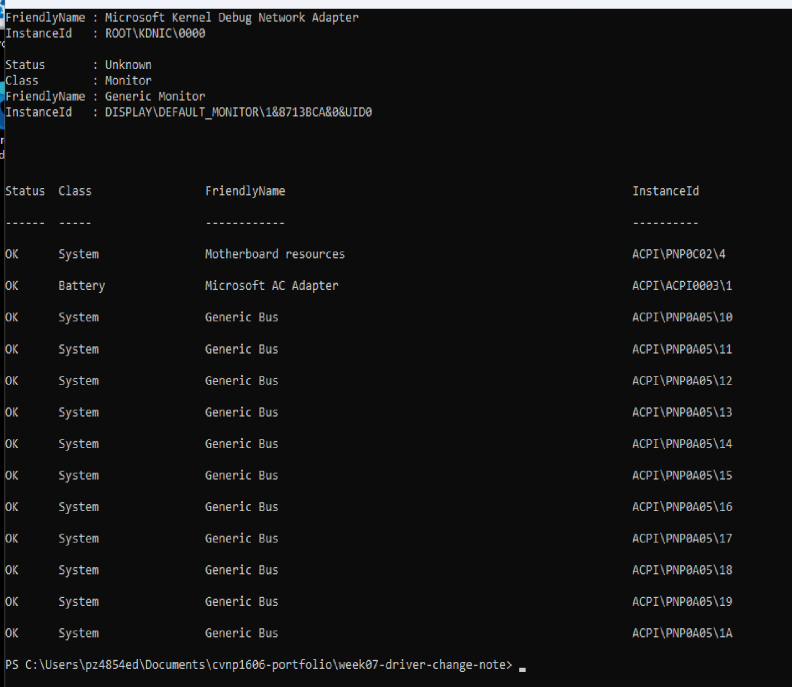
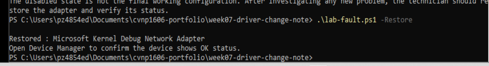
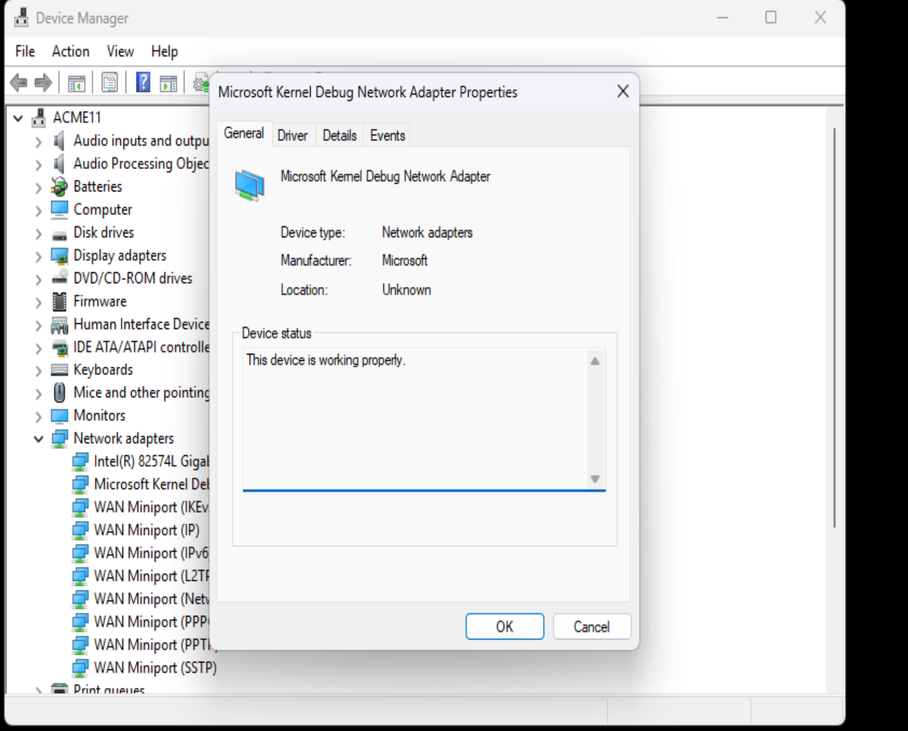
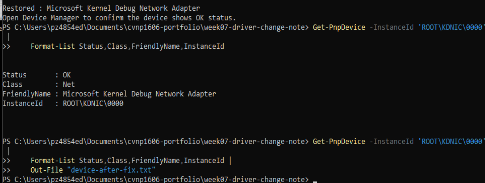

# Week 7 - Devices, Drivers, and Peripherals

## Overview

For Week 7, I investigated a simulated device failure on my Windows 11 virtual machine. I used the instructor's lab-fault.ps1 script to disable a network adapter and then collected evidence to identify the problem.

I checked the device status, Hardware ID, driver version, and rollback options before making any changes. After documenting the problem and preparing a rollback plan, I restored the device and verified that it was working properly.

## Ticket Information

- Ticket: CVNP1606-W07-007
- Computer: ACME11
- Device: Microsoft Kernel Debug Network Adapter
- Date: October 11, 2026
- Environment: Windows 11 virtual machine

## Tools Used

- Device Manager
- Windows PowerShell
- Get-PnpDevice
- lab-fault.ps1
- Get-ExecutionPolicy
- Windows driver properties

## Device Information

| Property | Result |
|---|---|
| Device | Microsoft Kernel Debug Network Adapter |
| Manufacturer | Microsoft |
| Hardware ID | root\kdnic |
| Instance ID | ROOT\KDNIC\0000 |
| Driver Provider | Microsoft |
| Driver Date | 6/21/2006 |
| Driver Version | 10.0.26100.8521 |
| Digital Signer | Microsoft Windows |
| Before Status | Disabled - Code 22 |
| After Status | OK |
| Roll Back Driver | Unavailable |

## Troubleshooting Process

### 1. What went wrong, or what could realistically have gone wrong?

The instructor's lab-fault.ps1 script disabled the Microsoft Kernel Debug Network Adapter to simulate a device failure. Device Manager reported Code 22, which means the device was disabled. In a real workplace, a disabled network device could interrupt network-related functionality depending on what the adapter is used for.

### 2. What evidence did you check first?

I opened Device Manager and enabled Show hidden devices to locate the affected adapter. I checked the General tab for the error code, the Details tab for the Hardware ID, and the Driver tab for the driver information. I also used Get-PnpDevice in PowerShell to collect the device inventory.

### 3. What did you try?

I ran the instructor's lab-fault.ps1 script to create the fault. After identifying the disabled adapter, I collected screenshots and exported the hardware inventory. I checked the Roll Back Driver option and found that it was unavailable.

### 4. What fixed it, or what would you try next?

I ran lab-fault.ps1 -Restore to re-enable the network adapter. I chose this method because the device was disabled rather than experiencing a confirmed driver failure. Reinstalling the driver would have been an unnecessary change for this specific problem.

### 5. How did you verify the result?

I opened Device Manager and confirmed the General tab reported that the device was working properly. The disabled indicator was gone. I also ran Get-PnpDevice against the device Instance ID and confirmed that its status was OK.

### 6. What was the support or security impact of the issue or fix?

A disabled network device could affect services that depend on that adapter. Restoring the adapter returned the simulated device to a working state without replacing its driver. Documenting the change and rollback procedure helps another technician understand what happened and how to respond if additional problems occur.

## Change and Rollback Decision

The Roll Back Driver button was greyed out, and the evidence showed that the device had been intentionally disabled.

I chose to restore the device using the instructor's script rather than uninstalling or replacing the driver.

This lab demonstrates recovery from a disabled-device fault. It does not demonstrate an actual driver rollback or reinstall.

The decision and results are documented in change-note.md.

The rollback procedure is documented in rollback-plan.md.

## Validation Results

| Test | Before | After |
|---|---|---|
| Device Manager status | Disabled - Code 22 | Working properly |
| Disabled-device indicator | Present | Removed |
| PowerShell device status | Non-OK | OK |
| Restore script | Not executed | Successfully executed |

## Evidence Files

- hardware-inventory.txt - Device information and PowerShell inventory
- device-after-fix.txt - PowerShell verification after restoration
- change-note.md - Troubleshooting findings and change documentation
- rollback-plan.md - Recovery and escalation instructions
- lab-fault.ps1 - Instructor's fault simulation script
- collect-evidence.ps1 - Instructor's evidence collection script
- evidence-report.txt - Final evidence verification, generated after completion

## Screenshots

### Fault Creation

### Before-State Evidence

### Restoration and Verification

## AI Disclosure

I used ChatGPT to help organize my troubleshooting documentation, PowerShell commands, README, change note, and rollback plan.

I verified the device information and troubleshooting results against my Windows 11 virtual machine.

Additional details are documented in ai-disclosure.md and ai-validation.md.

## What I Can Do Now

I can use Device Manager and PowerShell to investigate a device problem, document the driver information, restore the device, and verify the result so another technician can understand what was done.
